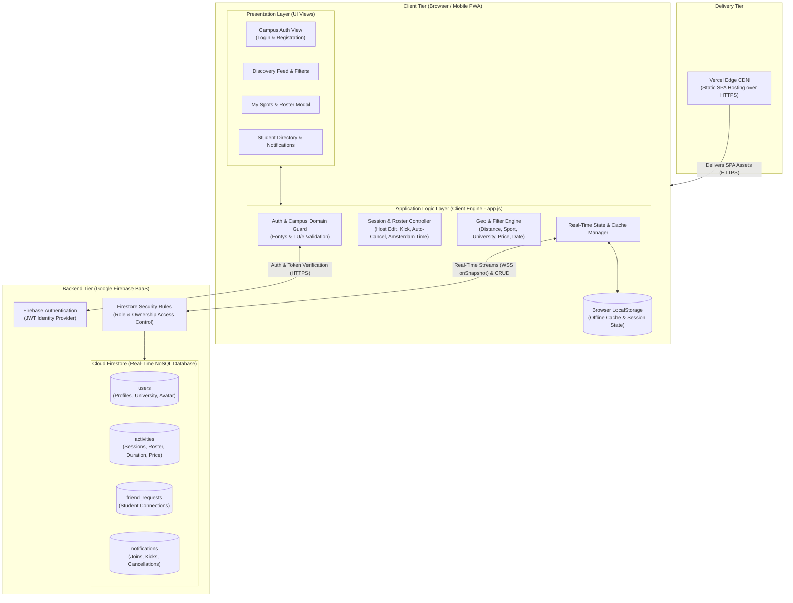

# UniSport Eindhoven — System Architecture & Topology

## 1. Visual Diagram (Mermaid — Auto-Rendered on GitHub)



---

## 2. PlantUML Source Code (`.puml`)

```plantuml
@startuml UniSport_System_Architecture_Topology
skinparam componentStyle rectangle
skinparam Shadowing false
skinparam packageStyle rectangle

package "Delivery Tier" {
  [Vercel Edge CDN\n(HTTPS Static SPA Hosting)] as CDN
}

package "Client Tier (Desktop Browser / Mobile PWA)" {

  package "Presentation Layer (UI Views)" {
    [Campus Auth View] as UIAuth
    [Session Feed & Filter Drawer] as UIFeed
    [My Spots & Roster Manager] as UISpots
    [Student Directory & Notifications] as UISocial
  }

  package "Application Logic Layer (UniSport Client Engine)" {
    [Auth & University Domain Guard\n(@student.fontys.nl / @student.tue.nl)] as LogicAuth
    [Session Lifecycle & Roster Controller\n(Amsterdam Time, Host Edit, Kick, Auto-Cancel)] as LogicSession
    [Geo & Multi-Filter Engine\n(Distance, Sport, Uni, Date, Price)] as LogicFilter
    [Real-Time Sync & State Manager] as LogicSync
  }

  database "Browser LocalStorage\n(Offline Cache & Active Session)" as LocalCache
}

package "Backend Tier (Google Firebase BaaS)" {
  [Firebase Authentication\n(JWT Identity Service)] as FBAuth
  [Firestore Security Rules\n(Ownership & Campus Access Control)] as SecRules

  database "Cloud Firestore (Real-Time NoSQL)" as Firestore {
    [users\n(Profile, University, Sport, Avatar)] as ColUsers
    [activities\n(Session, Host, Roster, Duration, Price)] as ColActs
    [friend_requests\n(Peer Connections)] as ColFriends
    [notifications\n(Joins, Kicks, Cancellations)] as ColNotifs
  }
}

CDN --> UIAuth : "Serves SPA Bundle (HTTPS)"

UIAuth <--> LogicAuth
UIFeed <--> LogicFilter
UISpots <--> LogicSession
UISocial <--> LogicSync

LogicSession --> LogicSync
LogicFilter --> LogicSync
LogicSync <--> LocalCache : "Hydration & Offline Fallback"

LogicAuth <--> FBAuth : "Verify Credentials & JWT (HTTPS)"
LogicSync <--> SecRules : "Real-Time WebSocket (onSnapshot)\n& Document Mutations"

SecRules --> ColUsers
SecRules --> ColActs
SecRules --> ColFriends
SecRules --> ColNotifs

@enduml
```
